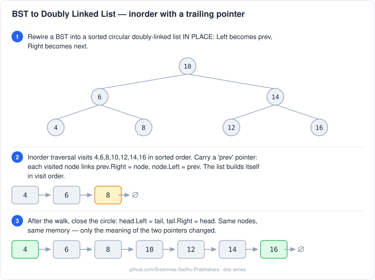

# Binary Tree to Doubly Linked List

> Striver SDE Sheet 146 · Day 22 Mixed — inorder with a trailing prev pointer; each visit welds prev↔current, reusing Left/Right as the list links. Go, stdlib only, tested.

## Problem

Convert a binary tree (classically a BST) into a doubly linked list in place and in inorder sequence: `Left` becomes prev, `Right` becomes next, no new nodes.

## Approach

An inorder traversal visits nodes in exactly the order the list needs — so conversion is just *what you do at each visit*: weld the previously visited node and the current one together (`prev.Right = n; n.Left = prev`). The first visit instead records the head. Rewiring `n.Left` at visit time is safe because inorder has already finished with that subtree; `n.Right` still holds the unvisited right child and is only overwritten by the *next* visit's weld — the ordering that makes in-place mutation legal. Terminate both ends with nil and the tests walk the list both directions to prove the back-links too.

**Complexity:** O(n) time, O(h) recursion.

## Visual walkthrough

Read the picture top to bottom — each numbered frame is one moment of the algorithm
running on this repo's test example.

## Run

    go test ./...   # verify
    go run .        # demo

---

One of 191 repos solving Striver's SDE Sheet in Go — stdlib only, one problem per repo, every solution tested. Browse the set: [`dsa-*` repos](https://github.com/Sreenivas-Sadhu-Prabhakara?tab=repositories&q=dsa-&type=source).
